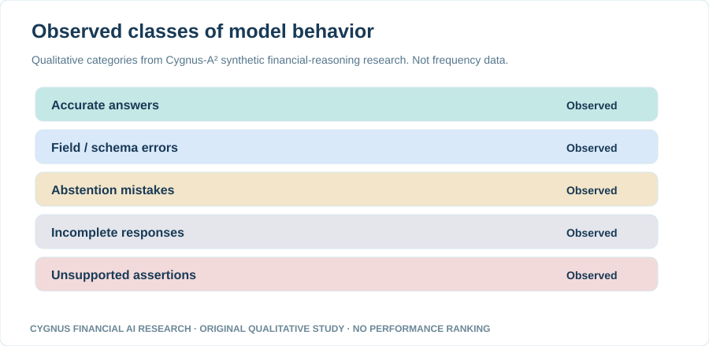

# Cygnus Financial AI Research

### Private Credit Model Intelligence

**Original research into the accuracy, reliability, safety and inference efficiency of AI models for financial reasoning.**

Cygnus-A² investigates how AI models handle evidence-intensive financial tasks—what they can demonstrate, when they should abstain, and where failures arise. Our publication is designed for financial institutions, researchers, model developers, investors and curious readers.

  

> **Research scope:** AI models applied to private-credit and collateral-intelligence tasks. This is not a general private-credit market publication, a credit approval service or investment advice.

---

## Latest original research

### Technical Report 001 — Early Lessons from Live Financial Reasoning Experiments with Nemotron

**Published November 7, 2026 · Original Cygnus-A² exploratory live inference · Synthetic financial scenarios**

Our first technical report documents qualitative outcomes from live Nemotron Lightning 3.5 30B research through Fireworks: supported answers, formatting issues, abstention mistakes, incomplete responses and unsupported assertions. It explains why a model producing plausible financial output is not the same as producing safe, evidence-supported decisions.

**[Read Technical Report 001 →](papers/001-original-nemotron-live-research/README.md)** · [Explore the three original figures](charts/technical-report-001/) · [View the publication index](research/INDEX.md)

*Figure: Qualitative categories observed in exploratory research. Equal-sized visual elements do not represent frequencies or performance scores. The study is not a head-to-head comparison, not production underwriting validation and not a current model leaderboard.*

## Research focus

| Research track | Questions we investigate |
|---|---|
| **Model comparison** | How can models be compared fairly on prespecified financial tasks and identical evidence? |
| **Numerical reasoning** | Do models calculate interest, balances, loan payments, LTV and debt-service measures correctly? |
| **Evidence reliability** | Are claims supported by sources, and can models recognize missing or contradictory data? |
| **Financial safety** | Do models avoid unsupported assertions, and do they abstain for the right reason? |
| **Structured outputs** | Are final responses complete, correctly identified and machine-readable? |
| **Inference efficiency** | What are latency, completion, reasoning-token and inference-cost trade-offs? |

## Research publications

| # | Date | Publication | Evidence type |
|---|---|---|---|
| 001 | Nov 2026 | **[Early Lessons from Live Financial Reasoning Experiments with Nemotron](papers/001-original-nemotron-live-research/README.md)** | Original exploratory live experiments; qualitative public disclosure |

**Research background and editorial resources**

- [Public research index and agenda](research/INDEX.md)
- [What makes a financial AI model trustworthy?](research/2026-11-financial-model-evaluation-agenda.md) — conceptual research questions
- [Why correct financial arithmetic is not enough](research/2026-11-arithmetic-vs-evidence.md) — educational primer
- [Planned visual model research series](research/PUBLIC-MODEL-RESEARCH-SERIES.md) — proposed studies, not completed experiments

## How we evaluate research findings

Our research distinguishes several independently measurable outcomes. **Numerical correctness is not the same as source support; schema compliance is not the same as financial validity; a safe abstention is not the same as answering correctly.**

Reports explicitly state whether evidence is a conceptual discussion, a synthetic live experiment, a controlled comparison or a validated production assessment. We preserve negative results and disclose sample selection, denominator rules, limitations, dates and model identifiers to the extent publication rights and confidentiality allow.

A comparative scorecard will be published only when appropriately matched model experiments have been completed and **the exact public measurements have been approved for release**. Until then, no model rankings or unverified performance percentages are implied.

**[Read the research methodology →](methodology/RESEARCH-STANDARDS.md)** · [Editorial and confidentiality policy](EDITORIAL-POLICY.md)

## Transparency, limitations and intellectual property

- The initial research uses **synthetic financial scenarios**, not real borrower portfolios, autonomous lending decisions or production underwriting validation.
- Results from selected exploratory cases cannot establish a general model winner.
- THAL3S 16, FIP and TCIB proprietary code, prompts, private evaluation datasets, reference answers, sensitive source receipts, unreleased metrics and risk mechanisms **are not published in this repository**.
- Public release requires a separate review of the exact narrative, graphs, data rights and methodological claims.
- Credentials, client data and restricted provider records must never be submitted here.

## Explore and follow

[Research catalogue](research/INDEX.md) · [Publication standards](methodology/RESEARCH-STANDARDS.md) · [Suggest a research topic or correction](../../issues) · [Contribution guidelines](CONTRIBUTING.md)

**Cygnus-A²** · [Official website](https://www.cygnus-a.technology/)

© 2026 Cygnus-A². All rights reserved unless expressly licensed.
