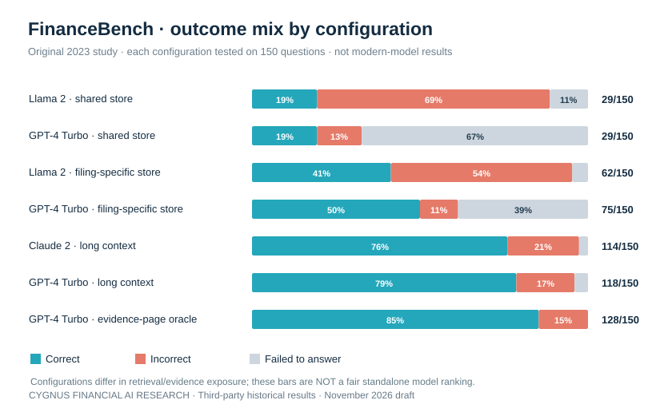
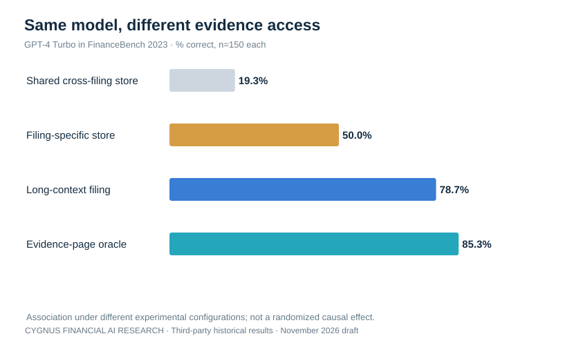
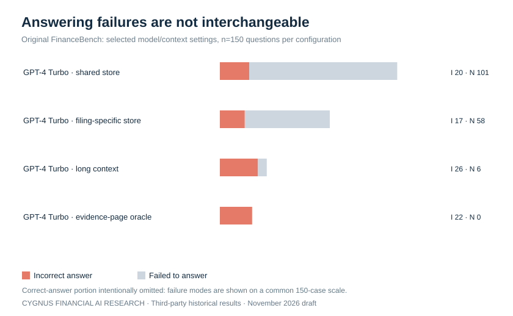
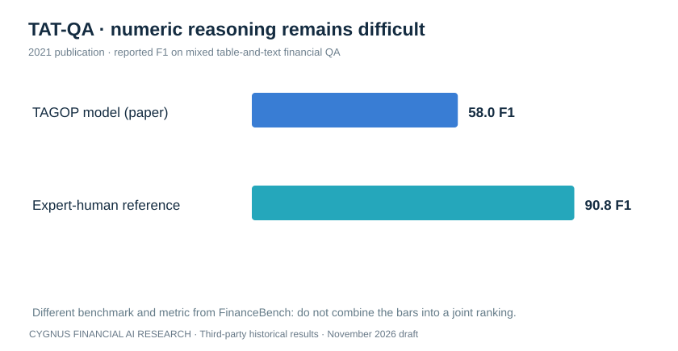
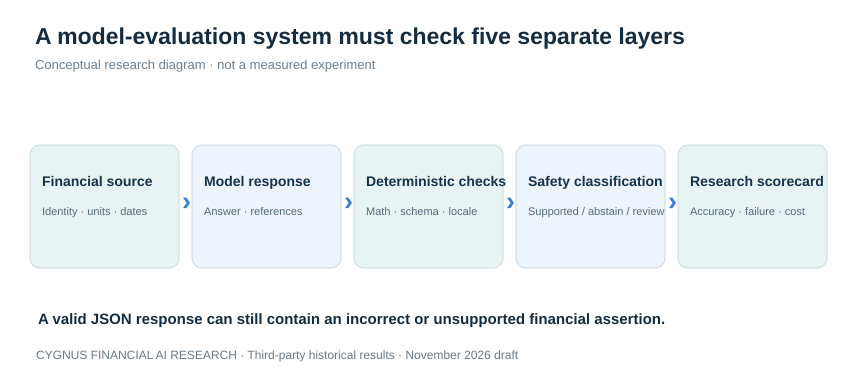

# Paper 001 (DRAFT) — Comparing AI Models for Financial Evidence: What Published Benchmarks Actually Measure

**Cygnus Financial AI Research · Model Intelligence Series · Draft dated 7 November 2026**

> **PUBLIC REVIEW DRAFT — NOT APPROVED FOR PUBLICATION.** Charts below are original visualizations of **third-party historical published studies**. These are **not Cygnus-A² live experiments**, not private-credit underwriting assessments, and not a ranking of current AI models.

## Executive summary

Financial question answering should be evaluated as a *system*, not simply as a name on a model leaderboard. The same model can show sharply different correctness depending on whether it receives the relevant filing, a retrieval store, or the exact evidence pages. Error reporting also changes materially when **incorrect answers** and **no answer** are separated.

This paper uses independently published **FinanceBench (2023)** and **TAT-QA (2021)** evidence to illustrate the measurement challenge. It does not disclose proprietary THAL3S 16/TCIB experiments.

**Five findings from the external literature:**

1. In FinanceBench, GPT-4 Turbo was reported correct on **29/150** questions with a shared vector store and **128/150** with the evidence-page oracle. Those configurations are not identical retrieval systems, so this is **not a pure causal model improvement**.
2. A model can return the wrong answer *or* fail to answer. These behaviors require separate reporting because they imply different operational risks.
3. FinanceBench tested 16 configurations on 150 publicly annotated examples (2,400 human-reviewed responses), while the full dataset is described as 10,231 questions.
4. TAT-QA researchers reported **TAGOP F1 58.0** versus **expert-human F1 90.8**, on a different financial task and metric. TAT-QA scores **must not** be ranked against FinanceBench correctness.
5. For private-credit-oriented model research, **numerical correctness, source validity, structured responses, abstention, safety and inference cost** should be examined as distinct dimensions rather than collapsed into a single marketing figure.

## Figure 1 — A model result has multiple possible outcomes

**Reading the chart:** All seven plotted configurations are drawn from the 2023 FinanceBench evaluation of the same 150-question sample. The shaded portions show correct, incorrect and failed-to-answer counts, as published. The context and retrieval methods vary; labels identify configurations rather than current product performance. The original publication includes additional configurations that are not plotted here. See the source table in [chart-data.csv](../../data/paper-001/chart-data.csv).

**What matters:** If a model returns no answer, it has not necessarily made an unsafe financial assertion. But refusing to produce a required answer can still be operationally unacceptable. The evaluation must distinguish both.

## Figure 2 — Evidence access changes the observed result

In the cited 2023 study, GPT-4 Turbo's correctness for four settings spans **29/150, 75/150, 118/150 and 128/150**. The oracle configuration provided the relevant evidence pages. This is an intentionally idealized retrieval condition, not a real-world workflow benchmark. The differences cannot all be attributed to language-model quality: source selection, context packaging and evidence access are changing as well.

A private-credit system must therefore assess the **complete evidence-to-response pipeline**, not simply assume a model's best published score applies to unstructured loan files.

## Figure 3 — Wrong answer and no answer are separate error classes

This figure deliberately shows only the incorrect and no-answer parts of selected FinanceBench results. It is not another leaderboard. Different failure types suggest different interventions: improved evidence retrieval and numerical reasoning for incorrect answers; controlled abstention and better completeness for missing responses. In safety-sensitive tasks, unsupported confident assertions may deserve greater scrutiny than an appropriately reported uncertainty.

## Figure 4 — A second benchmark emphasizes numerical reasoning

TAT-QA, an established financial-table-and-text question-answering benchmark, reports **58.0 F1 for TAGOP** and **90.8 F1 for expert humans** in its 2021 study. These F1 figures are not comparable to FinanceBench correctness percentages and do not describe current frontier-model performance. The relevance is that retrieving the right evidence and performing numerical operations across text and tables are distinct challenges.

## Figure 5 — Proposed research measurement stack

**Conceptual figure, not an empirical score.** A robust financial-model evaluation should test the five layers in sequence: financial-source integrity, model output, deterministic checks, safety disposition and reproducible scorecards. This is a general public measurement principle, not a disclosure of any proprietary Cygnus implementation.

## Suggested evaluation scorecard for future original model studies

| Dimension | Metric | Failure mode to retain |
|---|---|---|
| Strict financial correctness | Fully correct cases / all attempted cases | Wrong arithmetic, mismatched units, wrong claim identifiers |
| Evidence support | Supported material assertions / assertions made | Unverified source IDs or unsupported evidence |
| Abstention quality | Appropriate abstentions / cases requiring abstention | Confident response on conflicted, missing or malformed information |
| Response validity | Schema-valid final responses / attempted calls | Invalid JSON, missing fields, cutoff/empty |
| Operational reliability | Completion and error rate | Timeout, rate limit, incomplete answer |
| Latency | Median and tail response time | Slow but technically correct responses |
| Inference economics | Provider-confirmed bill or transparently calculated token cost | Confusion between posted prices and actual charge |
| Critical unsafe assertions | Cases with unsafe supported financial claim / all relevant tests | Unsupported credit or collateral conclusions |

All denominators, exclusions, sample selection and model versions must be declared before a quantitative comparative publication. A perfect JSON score does not establish financial correctness. A correct calculator does not establish underwriting competence.

## What these studies do **not** establish

- The 2023 and 2021 reported systems do not provide a current 2026 leaderboard for Nemotron, Muse Spark Open, or other modern models.
- The public-company filing benchmark does not evaluate legal collateral priority, actual private-credit loan approvals, underwriting policy or recoverability.
- Context configurations cannot be compared as if only the model changed.
- Measured performance on synthetic or curated financial QA cannot be marketed as safe autonomous lending.
- Neither source gives Cygnus-A² permission to publish proprietary model experiments or sensitive financial records.

## Research agenda for future Cygnus reports

A future **original** chart-heavy comparison may evaluate two or more live models on the same prespecified task distribution and evidence package with consistent configuration, frozen scoring, complete failure accounting and risk checks. Accuracy, safety, abstention, latency, reasoning tokens and cost would be reported separately with uncertainty. Such a study remains subject to a distinct approval and confidentiality review.

## Sources and reproduction notes

1. Islam, P. et al. (2023), *FinanceBench: A New Benchmark for Financial Question Answering*. [Research paper](https://arxiv.org/abs/2311.11944) · [Public sample and research repository](https://github.com/patronus-ai/financebench). Model outcomes visualized from the original 2023 paper's Table 2 and independently indexed in Stanford's [measurement database](https://aims.stanford.edu/measurement-db/financebench).
2. Zhu, F. et al. (2021), *TAT-QA: A Question Answering Benchmark on a Hybrid of Tabular and Textual Content in Finance*. [ACL Anthology record](https://aclanthology.org/2021.acl-long.254/).
3. Chen, Z. et al. (2021), *FinQA: A Dataset of Numerical Reasoning over Financial Data*. [EMNLP paper](https://aclanthology.org/2021.emnlp-main.300/). Cited for conceptual context; **no numerical model scores in the charts are taken from FinQA**.

**Source-date note:** The plotted FinanceBench results are historical **2023** results. The TAT-QA chart reproduces **2021** study figures. None of the plotted numbers originates from Cygnus-A²'s proprietary experiments.

**Data integrity note:** The published FinanceBench summary's closed-book row in a surfaced Table 2 transcription showed component counts that did not sum to 150. That row was excluded from visualizations pending direct source reconciliation; the seven charted rows each sum exactly to 150. This is not a claim that the authors' original data were incorrect.

**Reproducibility:** The seven displayed FinanceBench result rows are recorded as an editable [CSV](../../data/paper-001/chart-data.csv). Original Cygnus chart designs are SVG files tracked alongside the manuscript; chart source is public and contains no private experimental data.

---

*Status: Founder review draft only. Do not promote, merge, or announce quantitative results before final editorial and source verification.*
