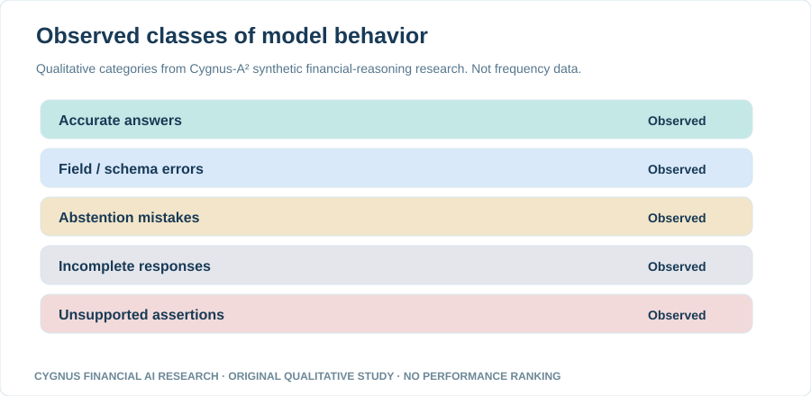
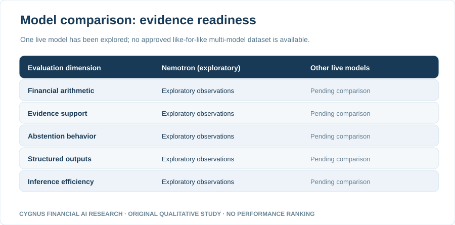
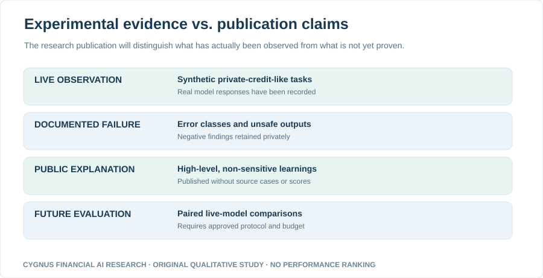

# Technical Report 001 — Early Lessons from Live Financial Reasoning Experiments with Nemotron

**Cygnus Financial AI Research · November 2026 · Founder review draft**

> **Research disclosure:** This technical report describes qualitative findings from Cygnus-A²'s own exploratory **live model inference** on **synthetic financial scenarios**. It contains **no comparative model leaderboard, accuracy percentages, case-level datasets, raw responses, prompts, or proprietary benchmark implementation**. It is **not evidence of production underwriting performance**.

## Executive summary

Cygnus-A² conducted exploratory live model experiments through Fireworks using **Nemotron Lightning 3.5 30B** for structured financial-reasoning tasks. The goal was to assess not only whether an AI model could produce financial answers, but whether its answers could be trusted as *complete, correctly structured and supported by the presented evidence*.

These small and iterative experiments yielded a mix of successful results and meaningful failures. The observations point to five distinct model behaviors deserving separate measurement: financial correctness, response-contract compliance, abstention quality, completion reliability and unsupported assertions. We do **not** release the underlying quantitative results in this initial report.

## Figure 1 — Observed behavior classes (qualitative)

**How to read:** Every row means an outcome category was observed in the internal experiments; the row length is purely a design element, **not a bar proportional to frequency, severity or performance**. Some experiments produced evidence-supported structured answers. Others showed incorrect output identifiers, wrong abstention explanations, incomplete responses after reasoning-budget exhaustion, or unsafe assertions. These are observations from synthetic, selected cases, not representative failure rates.

## Finding 1 — Financial correctness and response correctness are different

A model can perform an arithmetic step successfully but fail a strict machine-readable response contract. In financial workflows, an answer delivered under the wrong field identifier may be unusable even if its numeric content is plausible. A robust evaluation therefore separates mathematical validity from output-contract validity.

## Finding 2 — Refusal is only useful when the reason is correct

Missing evidence, contradictory evidence and malformed evidence have different meanings. In exploratory tests, the model sometimes avoided unsupported answers yet selected an inappropriate reason for abstaining. That outcome can be safer than fabricating a value, but it should not be scored as fully correct.

## Finding 3 — Longer reasoning does not ensure completion

Some complex financial questions produced no usable final answer within the configured response budget. Evaluations should report incomplete outputs explicitly and distinguish latency or reasoning-token usage from task success.

## Finding 4 — A supported-looking statement is not necessarily supported

In a financial setting, ambiguous numeric notation or mismatched source evidence can lead to plausible but unjustified assertions. Parseable JSON does not prove that a value is supported. This is why independent evidence verification, conservative interpretation and escalation matter.

## Figure 2 — Why this is not yet a model leaderboard

**How to read:** “Exploratory observations” means we have observed behavior for one live model in selected synthetic tasks. “Pending comparison” means this paper contains **no equivalent controlled data for any second model**. These labels are statuses, not performance scores. We will not invent a comparison.

## Figure 3 — From observation to defensible publication

This research sequence is conceptual. Historical model results remain in controlled private archives. Public research uses separately approved, non-sensitive descriptions until independent quantitative disclosure has been authorized.

## What would justify more live experiments?

A future comparative paper would require at least two clearly identified model endpoints, **the same prespecified synthetic tasks and input evidence**, a fixed evaluation rubric, case-level receipt tracking, outcome-category accounting and defensible cost/latency measurements. Cases used to tune prompts cannot also serve as an untouched final evaluation sample. Safety controls, spending boundaries and stop conditions must be validated before running a new live batch.

No live follow-up experiments are represented as completed in this report. **No cost, speed, accuracy or safety superiority claim** is made.

## Limitations and disclosures

- **Internal original research, synthetic inputs:** These observations do not represent actual loan approvals, real clients or production credit risk.
- **One tested model in the report:** Nemotron Lightning 3.5 30B; not a head-to-head model comparison.
- **Selective, small development cases:** The tested tasks were not an independent representative sample of private-credit transactions.
- **No public raw data or performance statistics:** Underlying proprietary datasets, exact scores, prompts and safety-control design remain private.
- **Not a model endorsement:** The report does not claim Nemotron, Fireworks or any other provider is fit for autonomous private-credit underwriting.

**Conclusion:** Early live research reinforces a central principle for evaluating financial AI models: a usable result must be numerically sound, evidence-supported, correctly structured and safely produced. The next step is controlled model-to-model experimentation, not premature ranking.

*Educational research only; not investment, lending or legal advice. Draft—requires founder review before publication.*
